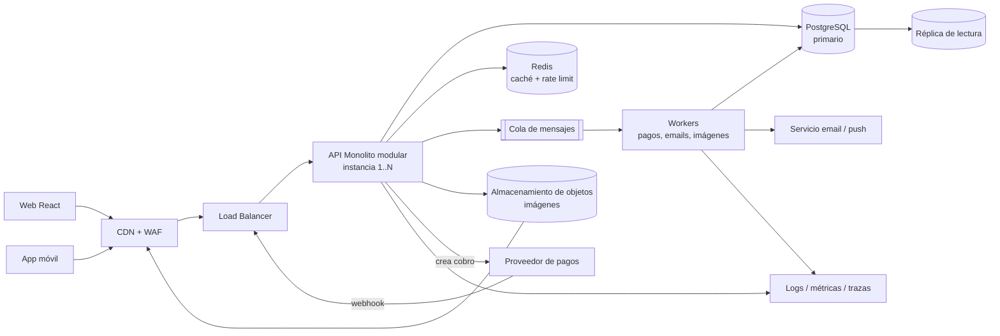

# Prueba Técnica Full Stack — Respuestas

**Stack asumido:** Node.js + TypeScript, React, PostgreSQL 15+. **Arquitectura:** agnóstica, basada en contenedores.

## Supuestos generales

- Autenticación con JWT de corta duración (access token) y refresh token rotativo. El `userId` sale del token, no de la petición.
- Los montos se guardan en centavos (entero). Una sola moneda por orden.
- El proveedor de pago ofrece idempotencia propia (clave por intento) y webhooks firmados. Es el caso de Stripe, MercadoPago y similares.
- Un solo país y una región de despliegue al inicio. Si hubiera multi-región, el diseño de datos cambiaría.

---

# 1. Revisión y optimización de código

## 1.1 Backend / API

### Problemas encontrados

| # | Problema | Categoría | Impacto |
|---|----------|-----------|---------|
| 1 | **Inyección SQL**: `userId` y `order.id` se concatenan en el SQL | Seguridad | Robo o borrado de datos |
| 2 | **IDOR / autorización rota**: cualquiera puede pedir `?userId=otro` | Seguridad | Fuga de pedidos ajenos |
| 3 | Sin autenticación en el endpoint | Seguridad | Acceso anónimo |
| 4 | **N+1 queries**: una consulta de ítems por cada orden | Rendimiento | Latencia lineal con el número de órdenes |
| 5 | `SELECT *` | Rendimiento / Seguridad | Trae columnas innecesarias o sensibles |
| 6 | **Sin paginación** ni límite | Rendimiento / Diseño | Respuestas enormes, memoria y timeouts |
| 7 | Sin validación de entrada (`userId` puede faltar, ser arreglo o texto) | Seguridad / Diseño | Errores 500 y comportamientos inesperados |
| 8 | **Sin manejo de errores** (`try/catch`): una excepción deja la petición colgada o tumba el proceso | Mantenibilidad | Caídas y errores sin contexto |
| 9 | Lógica de datos dentro del handler (sin capa de servicio/repositorio) | Mantenibilidad | Difícil de probar y reutilizar |
| 10 | Muta los objetos del resultado (`order.items = ...`) | Mantenibilidad | Efectos laterales poco claros |
| 11 | Sin logs, trazas ni `requestId` | Mantenibilidad | Diagnóstico imposible en producción |
| 12 | Ruta sin versión y respuesta sin formato estándar (sin metadatos de paginación) | Diseño de API | Cambios que rompen a los clientes |
| 13 | Sin límite de tasa (rate limiting) | Seguridad | Abuso y scraping |

### Versión mejorada

```ts
import { z } from 'zod';

const querySchema = z.object({
  limit: z.coerce.number().int().min(1).max(100).default(20),
  cursor: z.string().datetime().optional(), // created_at del último elemento
});

app.get('/api/v1/orders', requireAuth, async (req, res, next) => {
  try {
    const { limit, cursor } = querySchema.parse(req.query);
    const userId = req.user.id; // viene del token, nunca del cliente

    // Una sola consulta: órdenes paginadas + sus ítems agregados en JSON
    const { rows } = await db.query(
      `SELECT o.id, o.status, o.total_cents, o.created_at,
              COALESCE(
                json_agg(json_build_object(
                  'sku', oi.sku,
                  'quantity', oi.quantity,
                  'unitPriceCents', oi.unit_price_cents
                )) FILTER (WHERE oi.id IS NOT NULL), '[]'
              ) AS items
         FROM (
               SELECT id, status, total_cents, created_at
                 FROM orders
                WHERE user_id = $1
                  AND ($2::timestamptz IS NULL OR created_at < $2)
                ORDER BY created_at DESC
                LIMIT $3
              ) o
         LEFT JOIN order_items oi ON oi.order_id = o.id
        GROUP BY o.id, o.status, o.total_cents, o.created_at
        ORDER BY o.created_at DESC`,
      [userId, cursor ?? null, limit]
    );

    res.json({
      data: rows,
      nextCursor: rows.length === limit ? rows[rows.length - 1].created_at : null,
    });
  } catch (err) {
    next(err); // un middleware central responde 400/500 y registra con requestId
  }
});
```

Alternativa si el JSON agregado resulta pesado: dos consultas, la primera de órdenes y la segunda con `WHERE order_id = ANY($1)`. Siguen siendo 2 consultas en total, no N+1.

### Índices y ajustes de base de datos

- `CREATE INDEX ON orders (user_id, created_at DESC);` cubre el filtro y el orden de la paginación.
- `CREATE INDEX ON order_items (order_id);` para el join.
- Claves foráneas con `ON DELETE` definido y restricciones `NOT NULL`.
- Pool de conexiones acotado (por ejemplo `max` = 20) y `statement_timeout` para frenar consultas largas.
- Paginación por cursor (keyset) en lugar de `OFFSET`, que degrada con tablas grandes.

---

## 1.2 Frontend / React

### Problemas encontrados

1. **Muta el estado**: `products.push(...)` modifica el arreglo original y `setProducts(products)` guarda la misma referencia, así que React no re-renderiza de forma fiable.
2. **Bucle infinito**: `products` está en las dependencias del `useEffect`, y el efecto cambia `products`.
3. **Resultados acumulados**: cada búsqueda se agrega a la lista anterior en vez de reemplazarla.
4. **Sin debounce**: una petición por cada tecla.
5. **Condición de carrera**: las respuestas pueden llegar desordenadas y mostrar resultados de una búsqueda vieja.
6. **Sin loading, sin error y sin cancelación** (`AbortController`).
7. **`key={index}`**: causa errores de reconciliación al reordenar o filtrar. Debe usarse `p.id`.
8. **Concatenar la query a mano**: no codifica caracteres especiales. Usar `encodeURIComponent` o `params`.
9. `console.log` en el click y un handler nuevo en cada render.
10. Input sin `label` (accesibilidad).

### Evitar solicitudes excesivas

Aplicar **debounce** de unos 300 ms sobre el texto de búsqueda. Opcionalmente, no buscar con menos de 2 caracteres y cachear resultados por término.

### Respuestas fuera de orden, loading, error y cancelación

- Cada efecto crea un `AbortController`. El cleanup del efecto cancela la petición anterior, así una respuesta vieja nunca pisa a una nueva.
- Estados explícitos: `loading`, `error` y datos.
- Los errores por cancelación (`AbortError`) se ignoran.

### Código corregido

```tsx
function useDebounced<T>(value: T, delay = 300) {
  const [v, setV] = useState(value);
  useEffect(() => {
    const t = setTimeout(() => setV(value), delay);
    return () => clearTimeout(t);
  }, [value, delay]);
  return v;
}

function ProductList({ api }) {
  const [products, setProducts] = useState<Product[]>([]);
  const [search, setSearch] = useState('');
  const [status, setStatus] = useState<'idle' | 'loading' | 'error'>('idle');
  const debouncedSearch = useDebounced(search);

  useEffect(() => {
    const controller = new AbortController();
    setStatus('loading');

    api
      .get('/products', { params: { search: debouncedSearch }, signal: controller.signal })
      .then((res) => {
        setProducts(res.data);   // reemplaza, no acumula
        setStatus('idle');
      })
      .catch((err) => {
        if (err.name === 'CanceledError' || err.name === 'AbortError') return;
        setStatus('error');
      });

    return () => controller.abort(); // cancela la petición anterior
  }, [debouncedSearch, api]);

  const handleSelect = useCallback((p: Product) => { /* acción real */ }, []);

  return (
    <div>
      <label htmlFor="search">Buscar productos</label>
      <input id="search" value={search} onChange={(e) => setSearch(e.target.value)} />

      {status === 'loading' && <p role="status">Cargando…</p>}
      {status === 'error' && <p role="alert">No se pudo cargar. Intente de nuevo.</p>}
      {status === 'idle' && products.length === 0 && <p>Sin resultados.</p>}

      <ul>
        {products.map((p) => (
          <Product key={p.id} data={p} onSelect={handleSelect} />
        ))}
      </ul>
    </div>
  );
}
```

En una aplicación real se usaría **TanStack Query** (`useQuery` con `queryKey: ['products', debouncedSearch]`), que ya resuelve caché, cancelación, reintentos y condiciones de carrera.

---

## 1.3 SQL / datos

### Problemas de exactitud y rendimiento

1. `DATE(o.created_at)` sobre la columna **impide usar el índice** (no es sargable) y fuerza un escaneo completo.
2. **Zona horaria**: `DATE()` usa la zona de la sesión. Con `timestamptz`, "el día 1" puede variar según el servidor o el cliente.
3. **Exactitud**: `COUNT(o.id)` cuenta una vez por cada fila de `order_items`, así que **infla el número de órdenes**. Debe ser `COUNT(DISTINCT o.id)`.
4. `GROUP BY c.name`: dos clientes con el mismo nombre se mezclan. Debe agrupar por `c.id`.
5. `JOIN` interno: excluye clientes sin órdenes (correcto aquí, pero debe ser intencional).
6. Los descuentos, impuestos y órdenes canceladas no se filtran, así que el ingreso puede ser incorrecto.
7. `SUM` de decimales: usar `numeric` o centavos enteros, nunca `float`.

### Consulta reescrita

```sql
SELECT c.id,
       c.name,
       COUNT(DISTINCT o.id)               AS orders,
       SUM(oi.quantity * oi.unit_price)   AS revenue
FROM customers c
JOIN orders o        ON o.customer_id = c.id
JOIN order_items oi  ON oi.order_id   = o.id
WHERE o.created_at >= TIMESTAMPTZ '2026-10-01 00:00:00-05'   -- ajustar a la zona del negocio
  AND o.created_at <  TIMESTAMPTZ '2026-10-02 00:00:00-05'
  AND o.status = 'PAID'
GROUP BY c.id, c.name
ORDER BY revenue DESC;
```

### Índices

- `orders (created_at)` o, mejor, `orders (created_at) INCLUDE (customer_id, status)`, para filtrar por rango y evitar ir a la tabla.
- Si el filtro por estado es muy selectivo: índice parcial `WHERE status = 'PAID'`.
- `order_items (order_id) INCLUDE (quantity, unit_price)` permite un index-only scan.
- `customers (id)` ya existe por la clave primaria.

### Con cientos de millones de registros

- **Particionar `orders` por rango de fecha** (mensual). El filtro diario solo toca una partición.
- Índices **BRIN** sobre `created_at` en tablas de solo inserción: son diminutos y eficaces.
- **Tablas de resumen o vistas materializadas** (ingresos diarios por cliente), refrescadas por un job o incrementalmente. Los reportes no deben escanear la tabla transaccional.
- Mover analítica pesada a una **réplica de lectura** o a un almacén analítico.
- Archivar datos antiguos. Revisar el plan con `EXPLAIN (ANALYZE, BUFFERS)` y mantener estadísticas con `ANALYZE`.

---

# 2. Caso de arquitectura — CommerceHub

## Supuestos

- Tiendas (vendedores) múltiples, pero un solo flujo de checkout y una sola moneda al inicio.
- Equipo pequeño o mediano: se prioriza **simplicidad operativa**.
- 1.000 req/s en pico es manejable con un monolito escalado horizontalmente y una base de datos bien indexada. No exige microservicios.

## 13. Arquitectura de alto nivel



## 15. Componentes principales

| Componente | Elección | Razón |
|-----------|----------|-------|
| Frontend web | React (SPA o SSR para el catálogo y SEO) | Ya es el stack del equipo |
| App móvil | React Native o cliente nativo sobre la misma API | Reutiliza la API REST |
| Backend | Monolito modular Node/TS (módulos: catálogo, inventario, carrito, órdenes, pagos, usuarios, admin) | Un solo despliegue, límites claros entre módulos |
| Autenticación | JWT corto + refresh rotativo, o un proveedor OIDC (Keycloak, Auth0). RBAC con roles `customer`, `seller`, `admin` | No reinventar la autenticación |
| Datos | PostgreSQL con réplica de lectura | Transacciones ACID, índices y JSON |
| Caché | Redis: catálogo, sesiones, rate limiting y claves de idempotencia de corta vida | Reduce carga de lectura |
| Mensajería | Cola (RabbitMQ o SQS-like) con patrón **outbox** | Desacopla pagos, emails y notificaciones |
| Imágenes | Almacenamiento de objetos + CDN, subida con URL prefirmada, redimensionado asíncrono | La API no maneja binarios |
| Observabilidad | Logs JSON con `requestId`, métricas (Prometheus), trazas (OpenTelemetry), alertas | Diagnóstico y SLOs |

## 14. Flujo completo de «Pagar»

1. El cliente envía `POST /orders` con `Idempotency-Key`. El backend **valida y, en una transacción corta, crea la orden `PENDING_PAYMENT` y reserva el stock** con expiración (por ejemplo 15 min). Responde `201` con el `orderId`.
2. El backend llama al proveedor para crear el intento de pago **fuera de la transacción**, usando una clave de idempotencia (`orderId`). Devuelve al cliente un `paymentUrl` o `clientSecret`.
3. El cliente paga en el proveedor. La interfaz muestra "procesando" y consulta el estado de la orden (polling corto o SSE).
4. El proveedor envía el **webhook** de confirmación. El backend verifica la firma, guarda el `event_id` (único) y, en una transacción, marca la orden `PAID` y convierte la reserva en venta definitiva.
5. Se escribe un evento en la tabla **outbox** en esa misma transacción. Un worker lo publica y se envían el correo de confirmación y la notificación push.
6. Si el pago falla o la reserva expira, un job libera el stock y la orden pasa a `CANCELLED` o `EXPIRED`.

## 16. Consistencia

| Consistencia fuerte | Eventualmente consistente |
|--------------------|---------------------------|
| Stock y reservas | Catálogo mostrado (caché con TTL) |
| Estado de orden y pago | Notificaciones y correos |
| Idempotencia y eventos de webhook procesados | Búsqueda y recomendaciones |
| Auditoría de cambios de estado | Reportes y analítica |
| Autenticación y permisos | Contadores y métricas |

## 17. Overselling, cobros duplicados y webhooks duplicados

- **Overselling:** descuento atómico en la base de datos, `UPDATE inventory SET available = available - $q WHERE sku = $s AND available >= $q`. Si afecta 0 filas, no hay stock. Se complementa con la tabla de reservas con expiración.
- **Cobros duplicados:** clave `Idempotency-Key` en nuestra API y una clave de idempotencia por orden hacia el proveedor. Restricción `UNIQUE` de un intento de pago activo por orden.
- **Webhooks duplicados:** tabla `webhook_events` con `UNIQUE (provider, event_id)`. Se inserta primero; si ya existe, se responde `200` sin reprocesar. Las transiciones de estado son idempotentes (`PAID` no vuelve a `PAID`). Los webhooks pueden llegar fuera de orden, por lo que se valida la máquina de estados.

## 18. Escalar y recuperarse de fallas

**Escalar**
- API sin estado: autoescalado horizontal detrás del balanceador.
- Lecturas del catálogo: CDN y Redis, más réplica de lectura.
- Escrituras: un primario PostgreSQL con índices y consultas bien afinadas. Basta de sobra para 1.000 req/s.
- Picos de campaña: pre-calentar caché, colas para trabajo no crítico y rate limiting.

**Recuperarse**
- Base de datos con alta disponibilidad (réplica con failover automático), backups diarios y **WAL/PITR**. Probar la restauración periódicamente, porque un backup no verificado no cuenta.
- Al menos 2 instancias de API en zonas distintas, con health checks.
- Timeouts, reintentos con backoff y **circuit breaker** hacia el proveedor de pagos.
- Cola con reintentos y *dead-letter queue*.
- Con un objetivo de 99,9 % (unos 43 min de caída al mes) basta una región con varias zonas.

## 19. Monolito modular vs. servicios

**Inicio: un monolito modular** con módulos separados y sin acceso cruzado a las tablas de otro módulo. Despliegue y transacciones simples, y menos costo operativo.

**Se justifica separar cuando:**
- Un módulo necesita **escalar de forma distinta** (por ejemplo, el catálogo o el procesamiento de imágenes).
- **Equipos independientes** chocan en los despliegues.
- Hay requisitos de aislamiento de fallas o de cumplimiento (por ejemplo, pagos).
- El ciclo de despliegue de un módulo es muy distinto al resto.

Primeros candidatos: **procesamiento de imágenes y notificaciones** (ya viven en workers), después catálogo/búsqueda.

## 20. Decisiones técnicas clave (arquitectura agnóstica)

1. **Monolito modular en contenedores.** Es portable entre nubes y no exige orquestación compleja. Costo: se escala todo junto.
2. **PostgreSQL como fuente de verdad.** Da transacciones ACID para inventario y órdenes. Costo: las escrituras escalan verticalmente, aceptable a esta escala.
3. **Reserva de stock con expiración.** Cumple «reserva temporal durante el pago» sin transacciones largas. Costo: un job de limpieza.
4. **Patrón outbox + cola.** Los eventos no se pierden si el proceso cae entre guardar y publicar. Costo: un poco más de código y duplicados posibles, por lo que los consumidores son idempotentes.
5. **Contenedores sin dependencia de un proveedor, con CDN para estáticos e imágenes.** Evita el *lock-in* y cubre bien los picos de lectura. Si el equipo ya usa una nube, sus servicios gestionados reducen la operación.

---

# 3. Implementación backend + datos

## Modelo mínimo de tablas (pregunta 26)

```sql
CREATE TABLE inventory (
  sku        text PRIMARY KEY,
  available  integer NOT NULL CHECK (available >= 0),   -- red de seguridad final
  reserved   integer NOT NULL DEFAULT 0 CHECK (reserved >= 0),
  price_cents integer NOT NULL
);

CREATE TABLE orders (
  id           uuid PRIMARY KEY DEFAULT gen_random_uuid(),
  customer_id  text NOT NULL,
  status       text NOT NULL CHECK (status IN ('PENDING_PAYMENT','PAID','CANCELLED','EXPIRED')),
  total_cents  bigint NOT NULL,
  expires_at   timestamptz,
  created_at   timestamptz NOT NULL DEFAULT now()
);
CREATE INDEX ON orders (customer_id, created_at DESC);

CREATE TABLE order_items (
  id          bigserial PRIMARY KEY,
  order_id    uuid NOT NULL REFERENCES orders(id),
  sku         text NOT NULL REFERENCES inventory(sku),
  quantity    integer NOT NULL CHECK (quantity > 0),
  unit_price_cents integer NOT NULL      -- precio congelado al comprar
);
CREATE INDEX ON order_items (order_id);

CREATE TABLE idempotency_keys (
  key           text NOT NULL,
  customer_id   text NOT NULL,
  request_hash  text NOT NULL,           -- hash del cuerpo
  status        text NOT NULL CHECK (status IN ('IN_PROGRESS','COMPLETED')),
  response_code integer,
  response_body jsonb,
  order_id      uuid,
  created_at    timestamptz NOT NULL DEFAULT now(),
  PRIMARY KEY (customer_id, key)
);

CREATE TABLE webhook_events (
  provider  text NOT NULL,
  event_id  text NOT NULL,
  received_at timestamptz NOT NULL DEFAULT now(),
  PRIMARY KEY (provider, event_id)
);
```

## 21. Validaciones de entrada

- Header `Idempotency-Key`: obligatorio, UUID válido.
- `customerId`: obligatorio, formato esperado, y **debe coincidir con el usuario autenticado** (o el usuario tener permiso sobre él).
- `items`: arreglo con 1 a 50 elementos, sin `sku` repetidos (o se consolidan).
- `sku`: texto no vacío con formato válido. `quantity`: entero entre 1 y un máximo razonable (por ejemplo 100).
- Se rechazan campos desconocidos, el cuerpo demasiado grande y los tipos incorrectos (esquema Zod).
- **Precios y totales nunca vienen del cliente**: se leen de la base de datos.

## 22 y 23. Stock sin negativos y límites de la transacción

La clave es un `UPDATE` condicional **atómico**: la comprobación y el descuento ocurren en la misma sentencia, y la fila queda bloqueada hasta el commit. Si dos clientes compran la última unidad, el segundo espera y luego su condición `available >= q` ya es falsa.

Para evitar interbloqueos, se procesan los SKU **siempre en el mismo orden** (orden alfabético).

```ts
async function createOrder(input, idemKey, customerId) {
  const client = await pool.connect();
  try {
    await client.query('BEGIN');                                   // ← INICIO

    // 1) Idempotencia (ver sección 24)
    const claimed = await claimIdempotencyKey(client, customerId, idemKey, hash(input));
    if (claimed.replay) { await client.query('COMMIT'); return claimed.response; }

    // 2) Reservar stock: SKU ordenados para evitar deadlocks
    const items = [...input.items].sort((a, b) => a.sku.localeCompare(b.sku));
    let total = 0;
    const lines = [];
    for (const it of items) {
      const r = await client.query(
        `UPDATE inventory
            SET available = available - $2, reserved = reserved + $2
          WHERE sku = $1 AND available >= $2
        RETURNING price_cents`,
        [it.sku, it.quantity]
      );
      if (r.rowCount === 0) {
        // distinguir "no existe" de "sin stock"
        const exists = await client.query('SELECT 1 FROM inventory WHERE sku = $1', [it.sku]);
        throw exists.rowCount ? new OutOfStock(it.sku) : new NotFound(it.sku);
      }
      total += r.rows[0].price_cents * it.quantity;
      lines.push({ ...it, unit: r.rows[0].price_cents });
    }

    // 3) Crear la orden y sus ítems
    const o = await client.query(
      `INSERT INTO orders (customer_id, status, total_cents, expires_at)
       VALUES ($1,'PENDING_PAYMENT',$2, now() + interval '15 minutes') RETURNING id`,
      [customerId, total]
    );
    for (const l of lines) {
      await client.query(
        `INSERT INTO order_items (order_id, sku, quantity, unit_price_cents) VALUES ($1,$2,$3,$4)`,
        [o.rows[0].id, l.sku, l.quantity, l.unit]
      );
    }

    // 4) Guardar la respuesta para repeticiones
    const body = { orderId: o.rows[0].id, status: 'PENDING_PAYMENT', totalCents: total };
    await saveIdempotentResponse(client, customerId, idemKey, 201, body, o.rows[0].id);

    await client.query('COMMIT');                                  // ← FIN
    return { code: 201, body };
  } catch (e) {
    await client.query('ROLLBACK');                                // libera todo el stock reservado
    throw e;
  } finally {
    client.release();
  }
}
```

**Dónde empieza y termina la transacción:** `BEGIN` justo antes de reclamar la clave de idempotencia; `COMMIT` tras guardar la orden, los ítems y la respuesta. **Las llamadas HTTP externas quedan fuera**. Si algo falla en cualquier punto, el `ROLLBACK` deshace tanto las reservas como la orden.

El `CHECK (available >= 0)` es la red de seguridad final: aunque haya un bug, la base de datos rechaza un stock negativo.

## 24. Idempotencia

1. Al llegar la petición, se intenta `INSERT` de `(customer_id, key)` con `status = IN_PROGRESS` y el hash del cuerpo.
2. **Si el INSERT funciona**, se procesa y al final se guarda `COMPLETED` con el código y el cuerpo de respuesta.
3. **Si la clave ya existe y está `COMPLETED`** con el mismo hash, se **devuelve la misma respuesta guardada**, sin crear otra orden.
4. **Si existe con distinto hash**, se responde `422` (la misma clave con otro cuerpo es un error del cliente).
5. **Si existe `IN_PROGRESS`** (petición simultánea), se responde `409` con `Retry-After`.
6. Las claves caducan a las 24 h (job de limpieza).

La clave está en `PRIMARY KEY (customer_id, key)`, así que dos peticiones simultáneas no pueden ambas pasar el INSERT. Al estar dentro de la misma transacción que la orden, un fallo deja también la clave sin reclamar.

## 25. Códigos HTTP y estructura de errores

Formato único (similar a RFC 7807):

```json
{
  "error": {
    "code": "OUT_OF_STOCK",
    "message": "No hay stock suficiente para SKU-050.",
    "details": [{ "sku": "SKU-050", "requested": 1, "available": 0 }],
    "requestId": "req_8f2c..."
  }
}
```

| Caso | HTTP | `code` |
|------|------|--------|
| Datos inválidos (formato, cantidades, falta header) | `400` (o `422` si el esquema es válido pero el contenido no) | `VALIDATION_ERROR` |
| No autenticado / sin permiso | `401` / `403` | `UNAUTHORIZED` / `FORBIDDEN` |
| SKU o cliente inexistente | `404` | `NOT_FOUND` |
| Sin stock | `409` | `OUT_OF_STOCK` |
| Conflicto: misma clave en curso, o clave con distinto cuerpo | `409` / `422` | `IDEMPOTENCY_CONFLICT` |
| Error interno | `500` (sin detalles internos al cliente; se registra con `requestId`) | `INTERNAL_ERROR` |

Si el cliente debe reintentar, se envía `Retry-After`. Éxito: `201 Created` con `Location: /api/v1/orders/{id}`.

## 27. Integrar el pago sin transacción abierta

Se divide en dos fases con la orden como máquina de estados:

1. **Transacción corta:** se crea la orden `PENDING_PAYMENT` y se reserva el stock (el código de arriba). Se hace `COMMIT`.
2. **Fuera de la transacción:** se llama al proveedor con una clave de idempotencia (el `orderId`) y un *timeout* de pocos segundos. Si se agota el tiempo, la orden sigue `PENDING_PAYMENT` y se puede reintentar de forma segura con la misma clave.
3. **Confirmación por webhook** (y, como respaldo, un job que consulta al proveedor las órdenes pendientes antiguas): transacción corta que pasa a `PAID` o a `CANCELLED`, y libera la reserva.
4. Un job expira las reservas vencidas.

Así nunca se mantiene una conexión de base de datos bloqueada esperando a un tercero lento.

---

# 4. Frontend y experiencia de usuario

## 28. Estados de UI

`idle` → `validating` (errores de formulario en línea) → `submitting` (botón deshabilitado con spinner) → `confirmed` (pantalla de éxito) .

Además:
- `recoverable_error`: red, timeout o 5xx. Mensaje claro y botón «Reintentar» (con la **misma** `Idempotency-Key`).
- `fatal_error`: sin stock o datos inválidos que requieren acción del usuario (volver al carrito).
- `unknown`/`verifying`: se envió la petición pero no se sabe el resultado (ver 30).
- `payment_pending`: orden creada, esperando la confirmación del pago.

## 29. Evitar el doble envío sin bloquear al usuario

- Al hacer clic se pasa a `submitting` de inmediato y el botón se deshabilita.
- Se genera la `Idempotency-Key` **una vez por intento de compra** y se reutiliza en los reintentos. Aunque se envíe dos veces, el servidor crea una sola orden.
- Hay *timeout* en el cliente y, al vencer, el botón se reactiva como «Reintentar» (no queda bloqueado para siempre).
- Es el backend quien garantiza la idempotencia; deshabilitar el botón es solo comodidad.

## 30. Se pierde la conexión tras enviar el POST

No se asume ni éxito ni fallo:

1. Se muestra «Verificando tu pedido…» (estado `unknown`).
2. Se **reintenta el mismo POST con la misma `Idempotency-Key`**. Si la orden existía, el servidor devuelve la respuesta original; si no, la crea.
3. Alternativa o complemento: consultar `GET /orders?idempotencyKey=...` o la lista de pedidos recientes.
4. La clave se guarda en `sessionStorage` para sobrevivir a un refresco.
5. Se muestra el resultado real y, si sigue sin haber conexión, un mensaje claro de que se puede cerrar la pantalla sin riesgo de cobro doble.

## 31. Accesibilidad mínima

- Cada campo con `<label>` asociado; `autocomplete` correcto en la dirección.
- Errores junto al campo, enlazados con `aria-describedby`, con `aria-invalid="true"`, y un resumen con `role="alert"` que además mueve el foco al primer error.
- El error no depende solo del color (icono y texto).
- Botón «Pagar» real (`<button>`), con texto claro, `aria-busy`/`aria-disabled` al enviar, foco visible y área táctil suficiente.
- Navegación completa por teclado, contraste suficiente (WCAG AA), y mensajes de estado en regiones `aria-live`.

## 32. Estado local, global y *server state*

- **Local:** valores del formulario, errores de campo, estado de la UI del botón y modales abiertos.
- **Global (cliente):** sesión/usuario autenticado, carrito en curso, preferencias (idioma, tema). Con Context o Zustand.
- **Server state:** catálogo, pedidos, stock, precios y dirección guardada. Se gestionan con TanStack Query (caché, invalidación, reintentos) y **no se copian a un store global**. El servidor es la fuente de verdad (en el checkout, el total se recalcula en el backend).

---

# 5. Testing, seguridad y diagnóstico

## Ocho pruebas prioritarias del flujo de creación de orden

| # | Tipo | Prueba |
|---|------|--------|
| 1 | Unitaria | Validación de entrada: cantidades ≤ 0, SKU repetidos, cuerpo vacío, falta de `Idempotency-Key` |
| 2 | Unitaria | Cálculo del total con precios de la BD (nunca del cliente) y redondeo en centavos |
| 3 | Integración | Orden exitosa: crea orden, ítems, descuenta stock y devuelve `201` |
| 4 | Integración | Sin stock: `409`, `ROLLBACK` completo (no queda stock descontado a medias en otros SKU) |
| 5 | Integración (concurrencia) | Dos peticiones simultáneas por la última unidad: solo una gana, el stock termina en 0 y nunca negativo |
| 6 | Integración | Idempotencia: la misma clave dos veces (y en paralelo) crea una sola orden y devuelve la misma respuesta; la misma clave con otro cuerpo da `422` |
| 7 | Integración | Webhook duplicado o fuera de orden: no cambia dos veces el estado ni libera stock dos veces |
| 8 | E2E | Flujo de checkout con el proveedor simulado lento: sin duplicados, con reintento tras corte de red |

## Riesgos OWASP Top 10 y controles

| Riesgo | Control concreto |
|--------|------------------|
| **A01 Control de acceso roto** (IDOR en órdenes) | Autorizar siempre por el usuario del token; verificar propiedad del recurso en cada consulta; pruebas de acceso entre usuarios |
| **A02 Fallos criptográficos** | TLS en todo, hash de contraseñas con Argon2/bcrypt, cifrado de datos sensibles, no guardar datos de tarjeta (lo hace el proveedor, PCI) |
| **A03 Inyección** | Consultas parametrizadas, validación con esquema, ORM/query builder |
| **A04 Diseño inseguro** | Modelado de amenazas del checkout, límites de tasa, reserva con expiración |
| **A05 Configuración incorrecta** | Cabeceras de seguridad (helmet), CORS restrictivo, sin trazas de error al cliente, entornos separados |
| **A06 Componentes vulnerables** | `npm audit`/Dependabot/Trivy en CI, versiones fijadas con lockfile |
| **A07 Fallos de autenticación** | JWT cortos, refresh rotativo, bloqueo por intentos, MFA para administradores |
| **A08 Integridad de software y datos** | **Verificar firma del webhook**, pipeline firmado, revisión de código obligatoria |
| **A09 Fallos de logging/monitoreo** | Logs de auditoría (quién y cuándo), alertas ante anomalías, sin datos sensibles en los logs |
| **A10 SSRF** | Lista permitida de destinos para llamadas salientes; no seguir URLs enviadas por el usuario |

## Incidente: órdenes duplicadas solo cuando el proveedor responde lento

**Hipótesis más probable:** el cliente (o un proxy/balanceador) agota el tiempo y **reintenta**, y sin idempotencia el backend crea otra orden. También pueden duplicarse los webhooks.

Pasos de investigación:
1. Buscar en los logs, por `requestId`, órdenes duplicadas del mismo cliente con segundos de diferencia y comparar tiempos de respuesta del proveedor.
2. Revisar los *timeouts* de cliente, balanceador y backend. Si el balanceador corta antes que el backend, hay reintentos.
3. Comprobar si existe y se usa la `Idempotency-Key`, y si hay una restricción `UNIQUE` en la base de datos.
4. Revisar si hay reintentos automáticos del HTTP client o de la cola (*at-least-once*).
5. Revisar el procesamiento de webhooks: si no deduplica por `event_id`, un reintento del proveedor duplica el efecto.
6. Reproducir en un entorno de pruebas con un proveedor simulado lento.

Corrección: idempotencia obligatoria, `UNIQUE` por orden y por intento de pago, webhooks deduplicados, *timeouts* coherentes entre capas y alertas sobre duplicados.

## Migración de una columna usada por la versión anterior

Patrón **expand / migrate / contract**, en varias versiones:

1. **Expand:** agregar la columna nueva (nullable o con valor por defecto) sin tocar la antigua. Compatible con la versión anterior.
2. **Desplegar** código que escribe en ambas columnas y lee de la nueva con respaldo en la antigua.
3. **Backfill** de los datos existentes por lotes pequeños (sin bloquear tablas grandes), y verificación.
4. **Cambiar la lectura** solo a la columna nueva.
5. **Contract:** cuando ninguna versión usa la columna antigua, eliminarla en un despliegue posterior.

Se evitan `ALTER` bloqueantes (por ejemplo `CREATE INDEX CONCURRENTLY`), se prueba la migración con datos reales y cada paso es reversible.

---

# 6. DevOps y operación

## 33. Pipeline CI/CD mínimo

```mermaid
flowchart LR
    PR[Pull Request] --> L[Lint + typecheck]
    L --> T[Pruebas unitarias]
    T --> S[Auditoría de dependencias<br/>+ escaneo de secretos]
    S --> B[Build de imagen Docker]
    B --> I[Pruebas de integración<br/>con BD efímera]
    I --> M[Merge a main]
    M --> ST[Deploy a staging<br/>+ migraciones + E2E smoke]
    ST --> A{Aprobación}
    A --> P[Deploy a producción<br/>progresivo canary / rolling]
    P --> H[Health checks + monitoreo]
    H -- falla --> R[Rollback automático]
```



## 34. Dónde ejecutar cada paso

- **Linting y typecheck:** en cada PR, primer paso (falla rápido). También *pre-commit*.
- **Pruebas unitarias y de integración:** en cada PR, con una base de datos Postgres efímera en el pipeline.
- **Análisis de dependencias y vulnerabilidades:** en cada PR (`npm audit`, Trivy sobre la imagen) y periódicamente (Dependabot). Escaneo de secretos incluido.
- **Build:** una sola vez tras aprobar las pruebas; **la misma imagen** se promociona de staging a producción.
- **Migraciones:** como paso explícito del despliegue (job previo al arranque de la nueva versión), primero en staging. Deben ser compatibles hacia atrás (expand/contract).

## 35. Estrategia de rollback

- Las imágenes se versionan de forma inmutable. El rollback consiste en volver a desplegar la versión anterior, tras comprobarlo con health checks.
- Despliegue **rolling o canary**: si suben los errores o la latencia, se revierte automáticamente.
- Las migraciones son **compatibles hacia atrás**, por lo que se puede volver al código anterior sin revertir la base de datos. Se evitan los cambios destructivos hasta la fase *contract*.
- **Feature flags** para apagar una funcionalidad sin desplegar.
- Backup previo ante cambios de datos arriesgados.

## 36. Secretos y credenciales

- Un gestor de secretos (Vault, o el gestor de la nube/orquestador), **nunca en el repositorio** ni en la imagen.
- Se inyectan como variables de entorno o archivos montados en tiempo de ejecución.
- Secretos distintos por entorno, mínimo privilegio, rotación periódica y acceso auditado.
- Escaneo de secretos en CI (gitleaks) y, si alguno se filtra, rotarlo de inmediato.
- Los secretos del proveedor de pagos y la clave de firma de webhooks tienen su propia rotación.

## 37. Métricas y alertas críticas del checkout

**Métricas:**
- Tasa de conversión del checkout y tasa de éxito de pago.
- Latencia del `POST /orders` (p50, p95, p99) y tasa de errores 5xx y 4xx.
- Latencia y errores del proveedor de pagos; webhooks recibidos vs. esperados y su retraso.
- Órdenes `PENDING_PAYMENT` envejecidas, reservas expiradas, stock bajo o negativo (debe ser siempre 0).
- Órdenes duplicadas detectadas; profundidad y antigüedad de la cola; uso del pool de conexiones y de la base de datos.

**Alertas (accionables):**
- Tasa de error > 2 % durante 5 min, o p95 sobre el umbral.
- Caída brusca de pagos exitosos (anomalía frente a la media).
- Cualquier valor de inventario negativo, o cualquier orden duplicada.
- Cola con retraso creciente o mensajes en *dead-letter*.
- Webhooks que no llegan, y errores de verificación de firma.
- Consumo del presupuesto de error (SLO 99,9 %).

---

# 7. Comunicación técnica (≤ 250 palabras)

**La decisión más riesgosa** es resolver la reserva de inventario con un `UPDATE` condicional sobre una única fila por SKU en PostgreSQL. Es simple y correcta, pero en una campaña con 8.000 usuarios concurrentes sobre pocos SKU muy populares, todas las transacciones se serializan sobre las mismas filas y pueden formar una cola de bloqueos que sube la latencia del checkout.

**Alternativas evaluadas:**
1. Reservar en Redis con scripts atómicos y sincronizar luego con la base de datos. Es más rápido, pero añade un segundo sistema que debe mantenerse consistente y complica la recuperación ante fallas.
2. Dividir el stock de un SKU caliente en varios «cubos» (sharding de contador) para repartir los bloqueos.
3. Una cola que serialice las compras por SKU.

Elegí la fila única porque garantiza la corrección con la menor complejidad, y el volumen esperado (1.000 req/s en total) probablemente lo soporta.

**Información para confirmarlo:**
- Distribución real de las compras por SKU: cuántas unidades comparten los productos más vendidos en un pico.
- Resultados de una prueba de carga con el patrón de la campaña, midiendo la latencia p99 y la espera de bloqueos.
- Duración real de la transacción y tiempo medio de reserva.
- Si el negocio acepta una ligera sobreventa compensada, en lugar de una garantía estricta.

Si la prueba de carga muestra contención, pasaría al reparto en cubos antes de introducir Redis.
